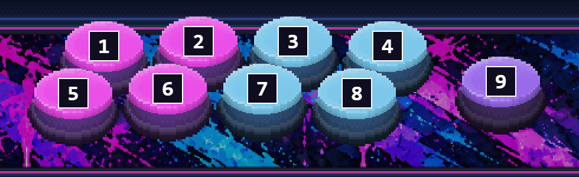

# Testing handoff and next work

Updated 2026-10-20. This is a build for owner testing; visual and OBS acceptance are pending.

## Build to test

- Branch: `arcade-overlay-v2` in the private SheldonTwitching/SheldonTwitching-Labels repository.
- Application baseline: `284e4091b87cc897b1357df5ba5f95979b963c67`.
- Installer: `SheldonTwitching-Command-Center-Setup-2.0.28.exe`.
- [Successful Windows build and private download artifact](https://github.com/SheldonTwitching/SheldonTwitching-Labels/actions/runs/39399815387).
- Verified: 100 Python tests, JavaScript parser/syntax/sprite/motion checks, CI packaging checks, archive and executable checksums, and the downloaded Windows executable running in isolated temporary profiles. Occupied legacy-port startup, valid Studio HTML, startup-notice data, preserved legacy bridge and repeated-launch reuse passed on both CI and the downloaded executable.
- Still unverified: installer upgrade with the owner's saved profile, full live OBS composition, physical controller mapping acceptance, selected music-source behavior, and account-specific chat/Spotify connections. Do not call this release-complete from automated tests alone.
- This handoff adds documentation and an audit image only. Application code is unchanged from build 2.0.28, so no replacement installer is needed for these notes.

## Owner test order

1. Keep a backup/export of the existing Studio project before testing an upgrade. Confirm saved palettes, button bindings, custom sprites/CSS and pinned roadmap ideas survive.
2. Compare Owner Original and Cabinet 1 in native 2060 x 1220 preview and measured 1920 x 1080 Gameplay output. Check the sloped marquee face reaches its trim, blue trim contains no residual pink, and the stacked logo keeps its proportions.
3. Check all nine visible controls: four upper buttons, four lower buttons, and the separate right button. See the numbered reference below. The prior missing-button report has not been reproduced in the development render; the owner's view still needs comparison. Do not dismiss a difference in the installed build or saved layout.
4. Press each of the nine physical buttons separately. Confirm the intended button lights and depresses, correct palette accent/rim appears, and release returns to neutral. Confirm all eight stick directions plus neutral, shaft anchoring and joystick-over-arrow layer order.
5. Place gameplay capture beneath the overlay in OBS. The protected 1920 x 1080 aperture is x197, y38, width1541, height868. Check capture reaches that edge without changing it to compensate for translucent art. Check reflection has no buttons/arrows and only a faint upright stick arc at the bottom glass edge.
6. Open scene, widget and independent cabinet-part sources from the app. Compare integrated and separately layered outputs, then close the editor and confirm sources remain live.
7. Select the intended music source. Check logo/lighting response, silence, mute and reconnect. Check weather/clock automatic Bangor settings and independent manual overrides. Rehearse Starting Soon, Gameplay, BRB and Outro with the chosen stage and frame rate.

## Next work, in priority order

1. **Resolve owner test findings first.** Record scene/source URL, build version, preview size, preset, saved layer order and screenshot for each mismatch. Add visual visibility checks for all nine control caps, beyond checking nine configured bindings.
2. **Finish the current cabinet before new shapes.** Refine authored cap/rim, trim and receiver masks against the read-only PSD. Preserve the mandatory pixel-art contract. Saved ball light-position settings remain inactive until directional masks preserve original pixel clusters and dithering. Keep glow separate from base sprite art.
3. **Unify the Intro cabinet.** Replace the older room-painted cabinet with the same registered parts and a shared perspective rig, preserving the approved Cabinet 1 marquee and paint logic.
4. **Complete six reusable Bangor-inspired stages.** Downtown Neon Alley, Bridge Underpass and Mill District art remain planned. Define seamless clouds/foreground animation, day/dusk/night masks and weather layers; retain 24/30/60 fps loops. Reuse stages in fighting intro, BRB and Outro, with at least one music-reactive object per stage.
5. **Improve widget access and previews.** Extend per-widget sizing, saved monitor layouts, layered preview composition, named text-reader recipes and reusable animation presets. YouTube/TikTok/Twitter-X account adapters remain planned, not connected features.
6. **Extend lighting efficiently.** Cache static pixel-art/material layers, animate separate emission/receiver/occlusion masks, share one audio state across sources, and profile the full OBS source stack before adding expensive effects.
7. **Build matching social and transition packages.** Use the approved stacked logo, graffiti panels and saved palette variables for banners/offline screens. Storyboard stingers, define covered-frame cut timing, and export transparent animation only after alpha-edge and OBS rehearsal checks.
8. **Try new cabinet silhouettes after current-shape acceptance.** Explore tournament-wide, tall/narrow and rounded/compact forms around the protected game aperture. Define panel thickness, trim paths, control clearance, surface materials and shadows for every design.
9. **Harden updates.** Test profile-preserving upgrades, then add signing and authenticated private update discovery. Keep the repository private and produce a fresh Windows installer for each application update.

See [the full roadmap](../../COMMAND_CENTER_ROADMAP.md) and [mandatory pixel-art contract](PIXEL_ART_CONTRACT.md). Owner-pinned ideas stay in the local Studio profile.

## Installed launch report and owner direction (2026-10-20)

An older Labels bridge on port47831 returns 404 for Studio. Windows listener reuse could let the new desktop window reach that older bridge. Startup now uses exclusive Windows binding, verifies Studio HTML/version before reuse, and selects a free nearby port with a visible notice when an earlier bridge is present. Existing bridges are left running. Verify this scenario with the replacement installer; the earlier 2.0.24 isolated headless smoke did not cover this conflict.

Unified chat is one combined chronological feed from all connected YouTube, Twitch, TikTok and Twitter/X accounts, with platform icons per message. Account adapters remain separately tracked planned work. The owner will supply OBS widget versions and collaborate on tip-bar styling. Native cabinet size is accepted; the owner will scale/zoom it in OBS.

Replacement build 2.0.27 verification: CI run39371961064 succeeded; archive/executable hashes verified and the downloaded Windows EXE passed the conflict and normal-route smoke checks. Owner installation and full OBS acceptance remain pending.

## Installed desktop verified (2026-10-20)

Follow-up error report: the installed file was still version2.0.24, and the browser tab referenced its earlier build run39361816840. Updated the actual per-user installation with the verified2.0.27 installer (exit0), checked the installed binary hash against the downloaded EXE, launched the installed Start-menu application and inspected its native desktop window. Studio at port47832 displayed Saved locally and the animated Starting Soon scene. The old Labels bridge on47831 remained running. This verifies installed GUI startup; full scene/input/audio/OBS acceptance remains separate. Use [build2.0.27](https://github.com/SheldonTwitching/SheldonTwitching-Labels/actions/runs/39371961064), not the old2.0.24 run.

## Pop-outs and organized workspace verified (2026-10-20)

Build2.0.28 / source284e409 / CI run39399815387 passed100 tests and the downloaded Windows executable checks. Reinstalled2.0.28, matched the installed hash, launched it using relocated User Data, and opened a separate native preview with fit/native size/zoom/background/fullscreen controls. Main app and preview were left open for owner testing.

Working checkout is now `C:/Twitch/SheldonTwitching 4.0/Codex Projects/Command Center/Project`. All254 then-tracked source files were hash-matched after the full checkout/build-history copy.314 reference copies were hash-verified, with no unavailable requested reference paths; six profile files were copied to User Data. Originals were retained. The local inventories live outside Git. User-requested reference archives and generation originals remain local/private.
